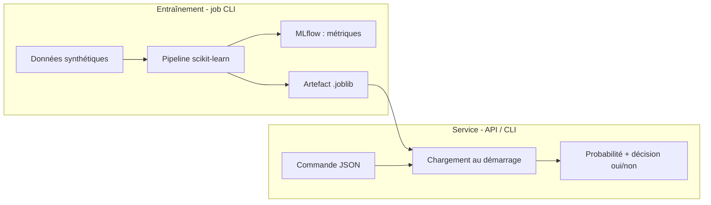

# Contribuer à Livraison Express Lite

Merci de votre intérêt pour le projet ! Ce guide explique comment fonctionne le projet et comment proposer une modification de façon efficace et cohérente avec le reste du code.

---

## Sommaire

1. [Comment fonctionne le projet](#1-comment-fonctionne-le-projet)
2. [Code de conduite](#2-code-de-conduite)
3. [Système d'issues](#3-système-dissues)
4. [Mettre en place l'environnement](#4-mettre-en-place-lenvironnement)
5. [Format du code](#5-format-du-code)
6. [Convention de commits](#6-convention-de-commits)
7. [Convention de pull requests](#7-convention-de-pull-requests)
8. [Règles spécifiques au projet](#8-règles-spécifiques-au-projet)

---

## 1. Comment fonctionne le projet

`livraison_express_lite` prédit si une commande peut bénéficier d'une **livraison express**. Une commande est décrite par des variables numériques et catégorielles : distance, poids, météo, zone, capacité du transporteur, etc.

### Le principe : séparer l'entraînement et le service



1. **Entraînement** (`train`) : des commandes synthétiques et reproductibles (graine `42`) sont générées, transformées (imputation, standardisation, one-hot), puis une régression logistique est entraînée. Les métriques partent dans MLflow et le modèle est écrit dans `MODEL_PATH`.
2. **Service** (`serve` ou `predict`) : le modèle est chargé **une seule fois**. Pour chaque commande, il calcule une probabilité, comparée au seuil `MODEL_THRESHOLD` pour produire la décision.

L'API ne réentraîne jamais le modèle : l'entraînement est un job contrôlé, pas un endpoint public.

### Les couches du code

| Couche | Rôle | Fichiers |
|---|---|---|
| `domain` | objets métier : commande, prédiction, *model card* | `domain/entities.py` |
| `core/learning` | pipeline, entraînement, prédiction, contrat des features | `ml_pipeline.py`, `ml_trainer.py`, `ml_predict.py`, `order_feature.py` |
| `core` | racine de composition : assemble tous les composants | `core/core.py` |
| `infrastructure` | contrats de stockage et implémentations | `order_repository.py`, `model_repository.py`, `implementation/dev/` |
| `api` | exposition HTTP (FastAPI) | `api/app.py` |
| `cli` | commandes `serve`, `train`, `predict` | `cli.py` |
| `config` | configuration par environnement (`.env`) | `config.py` |

Pour le détail (diagrammes, choix de conception, limites), lisez [ARCHITECTURE-livraison-express-lite.md](ARCHITECTURE-livraison-express-lite.md) avant votre première contribution.

---

## 2. Code de conduite

Ce projet applique un [Code de conduite](CODE_OF_CONDUCT.md). En participant, vous vous engagez à le respecter. En résumé :

- **soyez respectueux** : critiquez le code, jamais les personnes ;
- **soyez bienveillant** en revue de code : expliquez le pourquoi d'une remarque et proposez une alternative ;
- **acceptez les retours** et les points de vue différents ;
- **soyez inclusif** : aucune forme de harcèlement, d'insulte ou de discrimination n'est tolérée ;
- **respectez la vie privée** : ne publiez pas d'informations personnelles d'autrui.

Tout comportement inacceptable peut être signalé en privé aux responsables (voir la section *Signalement* du [Code de conduite](CODE_OF_CONDUCT.md)).

---

## 3. Système d'issues

Toute contribution commence par une **issue** sur GitHub : <https://github.com/Aym3ric/TP-industrialisation-IA/issues>.

> ⚠️ Une **faille de sécurité** ne se signale jamais dans une issue publique : suivez [SECURITY.md](SECURITY.md).

### Avant d'ouvrir une issue

- cherchez si une issue similaire existe déjà (ouverte **ou** fermée) ;
- vérifiez que vous utilisez la dernière version de `main`.

### Types d'issues

| Type | Titre | Contenu attendu |
|---|---|---|
| 🐛 **Bug** | `[Bug] <résumé>` | étapes pour reproduire, comportement attendu / observé, trace d'erreur, environnement (OS, Python, `ENVIRONMENT`) |
| ✨ **Évolution** | `[Feature] <résumé>` | le **besoin** d'abord, puis la solution envisagée et les alternatives |
| 📚 **Documentation** | `[Docs] <résumé>` | la page concernée et ce qui manque ou est faux |
| ❓ **Question** | `[Question] <résumé>` | le contexte et ce que vous avez déjà essayé |

Exemple de rapport de bug :

```markdown
**Étapes pour reproduire**
1. `python -m src.livraison_express_lite serve`
2. `curl -X POST http://127.0.0.1:8000/predict -d @order.json`

**Attendu** : une réponse 200 avec une prédiction
**Observé** : une erreur 500

**Trace** : (coller la trace complète)

**Environnement** : Windows 11, Python 3.13.1, ENVIRONMENT=local
```

### Labels

| Label | Signification |
|---|---|
| `bug` | comportement incorrect |
| `enhancement` | nouvelle fonctionnalité |
| `documentation` | documentation uniquement |
| `good first issue` | adaptée à une première contribution |
| `help wanted` | aide extérieure bienvenue |
| `question` | demande d'information |
| `wontfix` | ne sera pas traitée (raison expliquée en commentaire) |

### Cycle de vie d'une issue

1. **Ouverte** : un responsable la lit, ajoute les labels et demande des précisions si besoin.
2. **Assignée** : commentez « je m'en occupe » avant de commencer, pour éviter le travail en double.
3. **En cours** : une pull request y fait référence.
4. **Fermée** : automatiquement à la fusion de la PR (`Closes #<numéro>`), ou manuellement avec une explication.

Le projet suit le principe **YAGNI** : une évolution n'est acceptée que si un besoin concret la justifie. Une décision structurante (nouveau repository, changement de modèle…) est documentée sous forme d'ADR dans `docs/decisions/`.

---

## 4. Mettre en place l'environnement

```bash
git clone https://github.com/Aym3ric/TP-industrialisation-IA.git
cd TP-industrialisation-IA
python -m venv .venv
source .venv/bin/activate        # Windows : .venv\Scripts\Activate.ps1
pip install -r requirements.txt
pip install pytest ruff
cp .env.example .env
```

Vérifiez que tout fonctionne :

```bash
python -m src.livraison_express_lite train
python -m src.livraison_express_lite predict --file order.json
```

---

## 5. Format du code

### Outils

Le format est vérifié par [Ruff](https://docs.astral.sh/ruff/), configuré dans `pyproject.toml` :

```bash
ruff check .          # lint + tri des imports
ruff check . --fix    # correction automatique
ruff format .         # mise en forme
```

Une PR qui ne passe pas `ruff check .` n'est pas fusionnée.

### Règles

| Règle | Valeur |
|---|---|
| Version de Python | **3.13** |
| Style | PEP 8 |
| Longueur de ligne | **100** caractères maximum |
| Indentation | 4 espaces |
| Imports | triés (règle `I` de Ruff) : bibliothèque standard, puis tierces, puis locales |
| Typage | annotations de type sur toutes les fonctions publiques |
| Docstrings | en **français**, expliquent le *pourquoi* et les limites, pas seulement le *quoi* |

### Nommage

| Élément | Convention | Exemple |
|---|---|---|
| Classe | `PascalCase` | `MLPredict`, `OrderEntity` |
| Fonction, variable | `snake_case` | `get_predict_service`, `model_path` |
| Constante | `UPPER_SNAKE_CASE` | `FEATURE_COLUMNS` |
| Module | `snake_case` | `order_feature.py` |
| Fonction privée | préfixe `_` | `_train()` |

### Principes de conception

- respectez l'**architecture en couches** : `domain` ne dépend ni de FastAPI, ni de pandas, ni de l'infrastructure ;
- les services dépendent des **contrats** (`OrderRepository`, `ModelRepository`), pas des implémentations ; le choix des implémentations se fait dans `core/core.py` ;
- **aucune valeur en dur** (chemin, seuil, URL, secret) : passez par `config.py` et documentez la clé dans `.env.example` ;
- les erreurs ne sont jamais masquées silencieusement ;
- Clean Code, SOLID, KISS, DRY : voir la section 17 de la [doc d'architecture](ARCHITECTURE-livraison-express-lite.md).

### Tests

```bash
pytest
```

- tout nouveau comportement est accompagné d'un test ;
- toute correction de bug est accompagnée d'un test qui échouait avant la correction ;
- pour tester une orchestration, utilisez une doublure (faux modèle, repository en mémoire) plutôt qu'un vrai entraînement.

---

## 6. Convention de commits

Le projet suit [Conventional Commits](https://www.conventionalcommits.org/fr/) :

```text
<type>(<portée optionnelle>): <description à l'impératif, en minuscules>
```

| Type | Usage |
|---|---|
| `feat` | nouvelle fonctionnalité |
| `fix` | correction de bug |
| `docs` | documentation uniquement |
| `refactor` | restructuration sans changement de comportement |
| `test` | ajout ou correction de tests |
| `chore` | maintenance (dépendances, configuration) |
| `security` | correctif de sécurité |

Exemples :

```text
feat(api): valider les plages de distance_km
fix(cli): renvoyer 1 quand le modèle est introuvable
docs: documenter MODEL_THRESHOLD dans le README
```

---

## 7. Convention de pull requests

### Workflow

1. Partez de `main` à jour et créez une branche :

   ```bash
   git switch main
   git pull
   git switch -c <type>/<numéro-issue>-<description-courte>
   ```

   Exemples : `feat/12-sqlite-order-repository`, `fix/27-predict-missing-model`.

2. Faites des commits petits et cohérents (voir [section 6](#6-convention-de-commits)).
3. Poussez la branche et ouvrez une PR vers `main`.

On ne pousse **jamais** directement sur `main`.

### Contenu d'une PR

- **Titre** au format Conventional Commits : `feat(api): valider les plages de distance_km`
- **Une PR = un sujet** : ne mélangez pas une correction et une refonte.
- **Description** construite sur ce modèle :

```markdown
## Contexte
Closes #<numéro>
Pourquoi ce changement est nécessaire.

## Changements
- ce qui a été modifié

## Comment tester
Commandes ou requêtes pour vérifier le comportement.

## Checklist
- [ ] `ruff check .` passe
- [ ] `pytest` passe
- [ ] Tests ajoutés ou mis à jour
- [ ] Documentation mise à jour (README, `.env.example`, architecture)
- [ ] Aucun secret ni fichier `.env` commité
```

### Revue et fusion

- au moins **une approbation** d'un responsable est nécessaire ;
- toutes les discussions doivent être résolues avant la fusion ;
- l'auteur de la PR traite les remarques par de nouveaux commits (pas de `force push` pendant la revue) ;
- la fusion se fait en **squash and merge** : un commit propre par PR sur `main` ;
- la branche est supprimée après la fusion.

---

## 8. Règles spécifiques au projet

- **Ne modifiez pas le notebook** `notebooks/` : c'est l'artefact historique du projet, il doit rester identique octet pour octet.
- **Les features sont un contrat** : `FEATURE_COLUMNS` est défini une seule fois dans `core/learning/order_feature.py`. Renommer une feature impose de mettre à jour l'entité, l'API, l'entraînement et les tests dans la même PR.
- **La cible n'est jamais une feature**, et `order_id` non plus.
- **Ne commitez pas d'artefacts** (`*.joblib`, `artifacts/`) : ils se régénèrent avec `train`.
- **Pas d'endpoint d'entraînement** : l'entraînement reste un job CLI.
- **Dépendances** : tout ajout est justifié dans la PR et répercuté dans `requirements.txt` avec une version figée.

Merci pour votre contribution !
